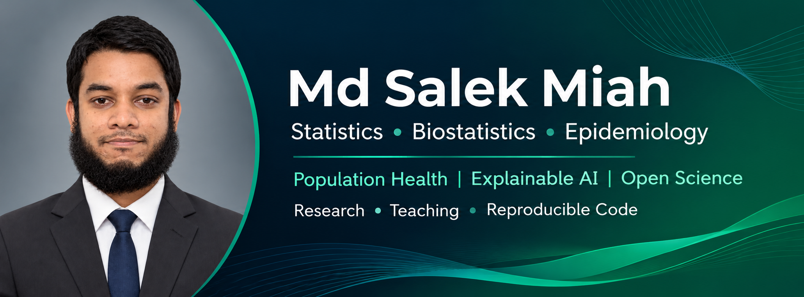
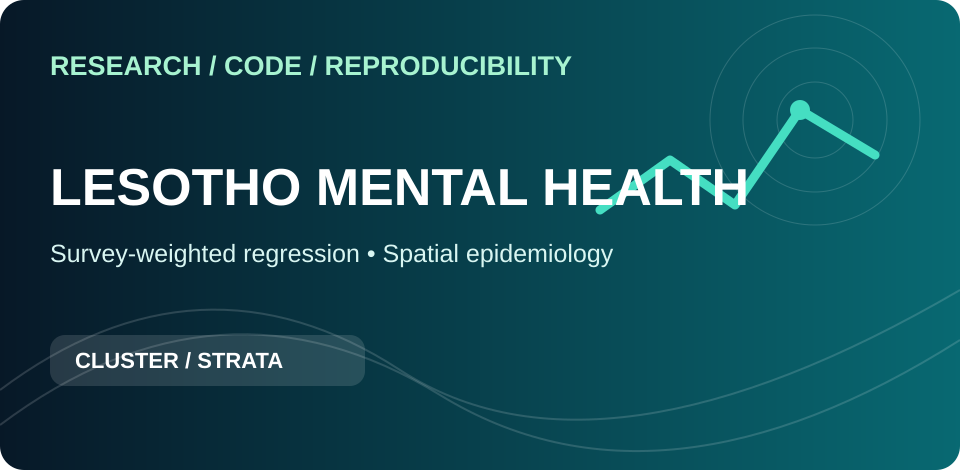
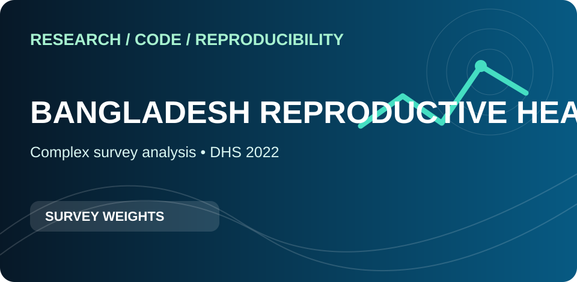
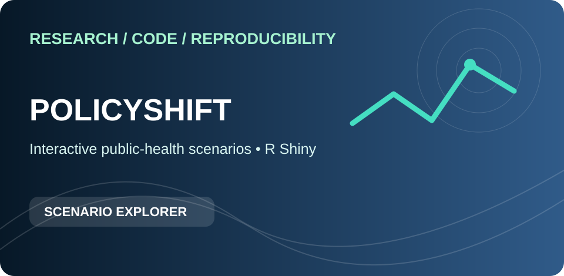
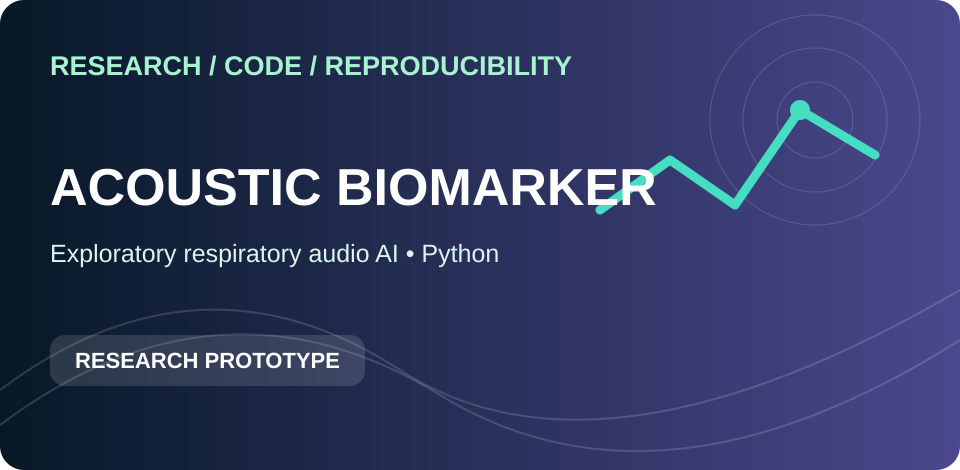
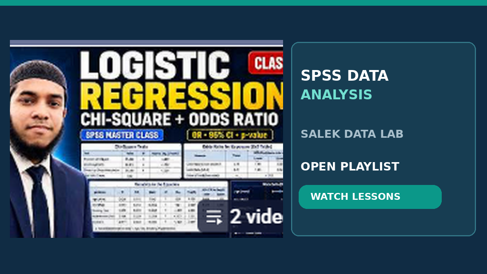

<!--
PROFILE README | github.com/muhammadsalek/muhammadsalek
Research-first visual portfolio. All publication, project, role and training claims
should be kept in sync with the most recent academic CV and official records.
-->

### Statistics Researcher · Biostatistics & Epidemiology · Open-Science Educator

**B.Sc. (Honours) in Statistics · SUST, Bangladesh · Expected April 2027**  
**Research Assistant · Research Instructor (CHBR / BIIHR) · GBD Collaborator (IHME)**  
**PhD interests: Biostatistics · Epidemiology · Population Health Sciences**

---

## Explore This Portfolio

[About](#about-me) · [Publications](#selected-peer-reviewed-publications) · [Flagship Projects](#four-flagship-research-projects) · [Research Experience](#research-experience) · [Supervisors](#research-supervisors-and-academic-mentorship) · [Teaching & YouTube](#teaching-and-research-capacity-building) · [Leadership](#research-leadership-and-grant-development) · [Peer Review](#academic-service-and-peer-review) · [Skills](#methods-and-technical-toolkit) · [Academic Activities](#conferences-awards-and-professional-development) · [GitHub Activity](#github-activity) · [Contact](#contact-and-phd-research-interests)

<table><tr>
<td align="center" width="33%"><a href="#selected-peer-reviewed-publications"><b>PEER-REVIEWED RESEARCH</b></a> Two sole-author highlights</td>
<td align="center" width="33%"><a href="#four-flagship-research-projects"><b>CODE &amp; APPLICATIONS</b></a> Published studies + research prototypes</td>
<td align="center" width="33%"><a href="#teaching-and-research-capacity-building"><b>EDUCATION &amp; OUTREACH</b></a> Video playlists + instructor roles</td>
</tr></table>

## About Me

I am **Md Salek Miah**, a final-year Statistics undergraduate at **Shahjalal University of Science and Technology (SUST), Sylhet, Bangladesh**. My research combines **biostatistics, epidemiological study design, complex survey methods, spatial analysis and explainable machine learning** to investigate population-health inequalities—particularly in maternal and reproductive health, mental health, and underserved communities.

My work spans secondary analysis of nationally representative household surveys, primary field-based data collection, clinical cohort research planning, statistical programming, and evidence synthesis. I am interested not just in whether a model identifies an association, but also in **sampling assumptions, measurement quality, missing information, effect heterogeneity, statistical uncertainty, reproducibility, and how findings should be interpreted for public-health decisions**.

Alongside research, I design and deliver training in **R, Stata, SPSS and applied statistics**, including open educational resources through **[Salek Data Lab](https://www.youtube.com/@SalekResearch)**.

> **Research perspective:** Develop transparent, defensible statistical evidence that improves how population-health inequalities are measured, interpreted and addressed.

**Current academic direction:** Fall 2027 PhD applications in **Biostatistics, Epidemiology, Population Health Sciences** and quantitative health research. I am particularly interested in training that joins rigorous statistical methodology with real biomedical and population-health questions.

### At a glance

| Research and service | Evidence from my academic record |
|:--|:--|
| **Peer-reviewed scholarship** | Multiple first-authored papers, including sole-author research in *Scientific Reports* and *PLOS ONE*; selected publications below |
| **Population-health datasets** | National demographic and health surveys, primary community surveys, and prospective clinical-study planning |
| **Field research** | Maternal-health fieldwork involving **800 women / 40 Union Parishads**; occupational-health survey involving **399 farmers** |
| **Clinical and ageing research** | Post-stroke longitudinal cohort collaboration; **1,200-participant** geriatric quality-of-life survey |
| **Academic service** | Peer review, statistical workshops and course instruction at CHBR/BIIHR; mentoring through Salek Data Lab |
| **Research leadership** | PI / team lead on a youth maternal-health research proposal; shortlisted proposal status, not a funding award |

## Research Agenda

<strong>1. Biostatistics, survey inference and epidemiological methods</strong>

- Complex survey design: weights, stratification, clusters, design-based estimation and regression.
- Generalized linear models, regression diagnostics, robust inference and missing-data considerations.
- Interpretable subgroup comparisons and geographical heterogeneity in population-health outcomes.
- Longitudinal and survival-analysis applications, with emphasis on developing stronger methodological foundations.
- Critical appraisal of how machine learning approaches handle complex survey sampling.

<strong>2. Maternal, reproductive and child health</strong>

- Skilled birth attendance, maternal health-service access and antenatal-care inequalities.
- Digital connectivity, reproductive healthcare needs and social determinants of health.
- Pregnancy-related knowledge, women's empowerment and subnational disparities.
- Child health, nutrition, WASH and developmental opportunities.

<strong>3. Mental health, women's autonomy and health equity</strong>

- Depression and anxiety across social, geographic and socioeconomic strata.
- Decision-making autonomy, intimate partner violence and mental-health outcomes.
- Rural–urban inequality and geographic patterns in multi-country survey studies.
- Measurement validity and responsible interpretation of observational associations.

<strong>4. Explainable ML, spatial methods and evidence synthesis</strong>

- Transparent predictive workflows: validation, calibration, model limitations and explainability.
- SHAP/LIME and related approaches for interpreting fitted models.
- Geographic visualization and GIS-based public-health evidence.
- Systematic reviews, screening, PRISMA documentation and methodological synthesis.
- Exploratory responsible AI applications in healthcare; research prototypes are **not clinical devices**.

## Education

**Bachelor of Science (Honours) in Statistics**  
**Shahjalal University of Science and Technology (SUST)** — Sylhet, Bangladesh  
**February 2023–Present** · **Expected graduation: April 2027**  
**Current CGPA: 3.20/4.00** (through Semester 3/2; 96 graded credits in the supplied CV)

**Selected completed coursework:**

| Mathematics foundations | Statistics and computing |
|:--|:--|
| Linear Algebra, Real Analysis, Calculus and Advanced Calculus | Probability Distributions, Theory of Statistics and Statistical Inference |
| Algebra, Differential Equations, Numerical Methods | Regression Analysis, Sampling Techniques, Design of Experiments |
| | Statistical Computing (with labs), Stochastic Processes |

**Current/planned advanced coursework (results pending):** Multivariate Analysis; Biostatistics and Epidemiology; Generalized Linear Models. Coursework status should be updated when examinations and grades are finalized.

**Academic objective:** Develop deeper methodological expertise through doctoral training and collaboration with researchers working on important real-world biomedical and public-health problems.

## Selected Peer-Reviewed Publications

### Sole-Author Research Highlights

| Paper | Contribution | Publication |
|:--|:--|:--|
| **Explainable machine learning analysis of factors associated with skilled birth attendance in Burkina Faso** | Independent study connecting interpretable ML to maternal-health determinants | **Sole author — *Scientific Reports* (2026)** · [Publication details](https://salek-prot.vercel.app/) |
| **Stratified and geographic patterns of depression and anxiety in Mozambican women: Mental health policy implications** | Independent analysis of mental-health inequality, stratified estimates and geographical variation | **Sole author — *PLOS ONE* (2026)** · [DOI](https://doi.org/10.1371/journal.pone.0356265) · [Code](https://github.com/muhammadsalek/mozambique-mental-health-analysis) |

These two independently authored papers best illustrate the central direction of my research: **transparent statistical modelling of population-health inequalities**. For all other works, authorship and publication status are specified individually below.

Selected publications from my supplied Fall 2027 academic CV. **The full and most current bibliography is on [Google Scholar](https://scholar.google.com/citations?user=oV99NYoAAAAJ) and my [research portfolio](https://salek-prot.vercel.app/).** Publication title, co-authorship and journal status should match the final publisher record.

| # | Publication | Journal / materials |
|:--:|:--|:--|
| **01** | **Explainable machine learning analysis of factors associated with skilled birth attendance in Burkina Faso** — *sole author* | *Scientific Reports* (2026) · [Publications](https://salek-prot.vercel.app/) |
| **02** | **Stratified and geographic patterns of depression and anxiety in Mozambican women: Mental health policy implications** — *sole author* | *PLOS ONE* 21(8), e0356265 (2026) · [DOI](https://doi.org/10.1371/journal.pone.0356265) |
| **03** | **Digital connectivity and mental health symptoms among women in Bangladesh: A rural–urban perspective** | *Discover Mental Health* (2026) · [Publications](https://salek-prot.vercel.app/) |
| **04** | **Intimate partner violence and the dual burden of anxiety and depression among women in Zambia: Spatial inequalities and implications for the sustainable development goals** | *Cambridge Prisms: Global Mental Health* (2026) · [Publications](https://salek-prot.vercel.app/) |
| **05** | **Decision-making autonomy and depressive symptoms among women in Lesotho: Rural–urban differences** | *Journal of Affective Disorders Reports* (2026) · [DOI](https://doi.org/10.1016/j.jadr.2026.101080) · [Code](https://github.com/muhammadsalek/Rural-Urban-Inequalities-in-Depression-among-Ever-Married-Women-in-Lesotho) |
| **06** | **Association between women's empowerment and mental health in sub-Saharan Africa and South Asia: Evidence from the Survey-based Women's Empowerment Index** | *Cambridge Prisms: Global Mental Health* (2026) · [Publications](https://salek-prot.vercel.app/) |
| **07** | **Explainable machine learning approaches to predict knowledge of pregnancy danger signs among women in the Haor region of Bangladesh** | *Global Health Research and Policy* (2026) · [Publications](https://salek-prot.vercel.app/) |
| **08** | **Association between internet use and unmet need for family planning among currently pregnant women in Bangladesh: Evidence from BDHS 2022** | *BMC Women's Health* (2026) · [DOI](https://doi.org/10.1186/s12905-026-04788-2) · [Code](https://github.com/muhammadsalek/BDHS-Unmet-Need-Analysis) |
| **09** | **Pregnancy loss and women's mental health in Zambia: A cross-sectional population-based and spatial analysis** | *Health Science Reports* (2026) · [Publications](https://salek-prot.vercel.app/) |

**Research themes represented:** maternal health · women’s empowerment · depressive symptoms · geographic disparities · survey-weighted regression · interpretable ML.

<strong>Manuscripts and evidence synthesis in progress (separate from published articles)</strong>

- **LLM-Based Well-Being Chatbot for Women: A Systematic Mini Review (2022–2026)** — first-author submission; systematic literature synthesis of AI-assisted women's mental-health tools, with ELITE Research Lab LLC.
- **Mental disorder status among university students in Bangladesh** — collaborative systematic review and meta-analysis; search screening, study selection and synthesis planning.
- **Best practices for machine learning with complex survey data** — collaborative methodological systematic review; PROSPERO registration **CRD420261399081**.
- **IHME GBD collaborator manuscripts** — collaborative revision work relating to dementia, dietary risks and dengue burden; these are **not presented as accepted or published papers**.
- **Other collaborative submissions** — details and current status are maintained in the academic portfolio; manuscripts under review are distinguished from published publications.

## Four Flagship Research Projects

<table>
<tr>
<td width="50%" valign="top"> <b>Lesotho — Mental-Health Inequalities</b> Published epidemiological study · Survey-weighted models · Spatial heterogeneity <a href="https://github.com/muhammadsalek/Rural-Urban-Inequalities-in-Depression-among-Ever-Married-Women-in-Lesotho">Code</a> · <a href="https://doi.org/10.1016/j.jadr.2026.101080">Paper</a></td>
<td width="50%" valign="top"> <b>Bangladesh — Reproductive Healthcare</b> Published DHS 2022 study · Digital connectivity · Survey-weighted regression <a href="https://github.com/muhammadsalek/BDHS-Unmet-Need-Analysis">Code</a> · <a href="https://doi.org/10.1186/s12905-026-04788-2">Paper</a></td>
</tr>
<tr>
<td width="50%" valign="top"> <b>PolicyShift — Public Health Scenario Explorer</b> R Shiny · Subgroup comparison · Exploratory modeling (not causal estimates) <a href="https://salek.shinyapps.io/policyshift/">Live application</a></td>
<td width="50%" valign="top"> <b>AcousticBiomarker-GH — Audio AI</b> Python · Respiratory audio classification · Experimental, not clinically validated <a href="https://acoustic-biomarker-gh-salek05.streamlit.app/">Live application</a></td>
</tr>
</table>

**Other research code:** [Mozambique mental health](https://github.com/muhammadsalek/mozambique-mental-health-analysis) · [Statistics for Scientists](https://github.com/muhammadsalek/statistics-for-scientists) · [DHS Data Analysis with Stata](https://github.com/muhammadsalek/DHS-Data-Analysis-with-STATA)

---

## Research Experience

### Research Assistant — Biostatistics and Population Health
**SUST Research Centre / research group** · **Prof. Md Jamal Uddin (PI)**  
**January 2024–Present** · Sylhet, Bangladesh

- Conduct research involving demographic and health surveys, statistical regression, social determinants of health and reproducible programming workflows.
- Work on quantitative questions spanning maternal health, women's mental health and population-level inequalities.
- Contribute to a prospective longitudinal study of **post-stroke disability and quality of life**, in collaboration with clinicians at **Sylhet M.A.G. Osmani Medical College Hospital**; study design and analysis planning are distinguished from completed cohort outcomes.
- Translate epidemiological research questions into documented analysis procedures, manuscript figures and interpretable results.

### Research Assistant — Maternal and Newborn Health
**SUST Research Centre** · **Prof. Md Zakir Hossain**  
**July–December 2025** · Bangladesh

- Supported survey fieldwork, data-quality checks and research documentation involving **800 women across 40 Union Parishads** in northeastern Bangladesh.
- Contributed to quantitative analysis and first-author manuscript development on maternal healthcare access in the Haor region.
- Research accepted for presentation at the **2nd International Conference of Physical Sciences, SUST (December 2026)** according to the supplied CV.

### Research Assistant — Geriatric Quality of Life
**SUST Research Centre** · **Prof. Sabina Islam**  
**July 2024–June 2026**

- Analyzed a **1,200-participant** geriatric quality-of-life survey using multivariable statistical modelling.
- Supported university-funded reporting, manuscript preparation and dissemination planning.

### Research Assistant — Occupational and Population Health
**SUST Research Centre** · **Prof. Mohammad Ohid Ullah**  
**December 2024–October 2026**

- Contributed to questionnaire development, field data collection and analysis of pesticide-related occupational exposures among **399 farmers**.
- Supported environmental and occupational health research presented at **EFAST 2026**.

### Biostatistician — Manuco Research Center
**2026–Present** · Bangladesh

- Statistical and manuscript contribution to a cross-sectional study of **461 older and widowed beneficiaries** concerning social-allowance delivery, mental well-being and depressive symptoms.
- Manuscript reported as submitted to *Journal of Affective Disorders*; **not represented here as accepted or published**.

### Research Assistant — Cognitive Solution Bangladesh / TeamCSBD
**January–July 2025**

- Analysis of Bangladesh demographic and health survey data for child nutrition, WASH and sociodemographic disparities.
- Participated in collaborative research documentation and interpretation of subgroup patterns.

### Research Intern — ELITE Research Lab LLC
**2026–Present** · Remote / interdisciplinary research team

- Contribute to research at the intersection of **large language models, responsible AI and women’s mental health**.
- Work on the first-author **LLM-Based Well-Being Chatbot for Women: A Systematic Mini Review (2022–2026)**, including structured evidence synthesis and research documentation.
- Explore methodological challenges in evaluating digital-health AI systems and communicating research limitations.
- **Status distinction:** This is research experience; the systematic review is submitted/in progress, not a published paper.

### Other Research Collaborations

- **University of Dhaka faculty research collaboration:** survey-weighted count and multinomial regression in reproductive-health datasets, including Conway–Maxwell–Poisson modelling.
- **Clinical collaborators:** longitudinal-analysis planning and post-stroke cohort protocol development.
- **CHINTA Research Bangladesh:** collaborative research-fellow involvement since 2024, as recorded in earlier profile materials.
- **Global Burden of Disease (GBD) Collaborator Network, IHME:** collaborator training and research participation; collaborative outputs clearly distinguished from individual first-author papers.

For a complete appointment and project chronology: **[Research Experience — Portfolio](https://salek-prot.vercel.app/)**.

## Research Supervisors and Academic Mentorship

My research training is grounded in multiple supervised projects at **Shahjalal University of Science and Technology (SUST)**. These names identify **the supervisors associated with the research appointments listed in my academic CV**; they do not imply that every supervisor advised every publication.

| Faculty supervisor | Research collaboration | Project / contribution |
|:--|:--|:--|
| **Prof. Md Jamal Uddin** | Biostatistics and population health · Jan 2024–present | Survey-based population-health research and prospective post-stroke cohort collaboration |
| **Prof. Md Zakir Hossain** | Maternal and newborn health · Jul–Dec 2025 | Haor fieldwork involving 800 women across 40 Union Parishads |
| **Prof. Mohammad Ohid Ullah** | Occupational and population health · Dec 2024–Oct 2026 | Pesticide exposures and farmer health survey (n=399) |
| **Prof. Sabina Islam** | Geriatric quality of life · Jul 2024–Jun 2026 | Older-adult quality-of-life study (n=1,200) |

For formal faculty affiliations, project documentation, and additional collaborators, see my **[academic research portfolio](https://salek-prot.vercel.app/)**.

---

## Research Leadership and Grant Development

### Principal Investigator and Team Lead — Youth Maternal-Health Research Proposal
**YOUReach Youth Research Grants for Action 2026**

- Led an interdisciplinary three-person team developing a proposal on **antenatal-care inequalities in climate-vulnerable Haor communities**, with a planned comparison to population-based survey evidence.
- Coordinated research aims, quantitative design considerations, role allocation and proposal development.
- **Status:** Reported **shortlisted for interview**. This entry **does not claim that funding was awarded**.

### Additional Leadership and Academic Engagement

- **Founder and instructor — Salek Data Lab (2025–Present):** research education through practical Bengali-language statistical programming tutorials.
- **Youth Neglected Tropical Diseases Taskforce coordinator (2026–Present):** academic/public-health outreach and coordination, per supplied CV.
- **Research capacity building:** development of workshops, practical computing exercises and reproducibility resources for students and researchers.

## Research Code and Software

### Reproducible Research Repositories

| Project | Scientific focus | Tools / evidence |
|:--|:--|:--|
| **Lesotho: autonomy and depressive symptoms** | Rural–urban comparisons, survey regression and geographic patterns | [GitHub repository](https://github.com/muhammadsalek/Rural-Urban-Inequalities-in-Depression-among-Ever-Married-Women-in-Lesotho) · [Article](https://doi.org/10.1016/j.jadr.2026.101080) |
| **Bangladesh: digital access and unmet family-planning need** | Survey-based reproductive health inequalities | [GitHub repository](https://github.com/muhammadsalek/BDHS-Unmet-Need-Analysis) · [Article](https://doi.org/10.1186/s12905-026-04788-2) |
| **Mozambique mental-health analysis** | Depression/anxiety and geographic inequality | [GitHub repository](https://github.com/muhammadsalek/mozambique-mental-health-analysis) · [Article](https://doi.org/10.1371/journal.pone.0356265) |
| **Statistics for Scientists** | Open-source statistics learning resources and code | [GitHub repository](https://github.com/muhammadsalek/statistics-for-scientists) |
| **DHS Data Analysis with Stata** | Survey-data preparation, estimation and applied reporting | [GitHub repository](https://github.com/muhammadsalek/DHS-Data-Analysis-with-STATA) |
| **R for Public Health DHS** | Research-oriented R workflows for DHS datasets | [GitHub repository](https://github.com/muhammadsalek/R-for-Public-Health-DHS) |
| **SPSS for Research** | Applied SPSS syntax, lessons and analysis exercises | [GitHub repository](https://github.com/muhammadsalek/SPSS-for-Research) |

> **Data governance:** Individual-level survey microdata may be subject to source-specific permissions. Public repositories should contain code and sharable derived outputs, not restricted individual-level records or confidential peer-review correspondence.

### Research Applications and Demonstrations

| Software / demo | Research or teaching purpose | Access / qualification |
|:--|:--|:--|
| **PolicyShift** | Interactive R Shiny prototype for survey-based policy scenarios and subgroup comparisons | [Open app](https://salek.shinyapps.io/policyshift/) · **illustrative, not validated causal effects** |
| **Academic Design Studio** | Research document preparation and formatted academic outputs | [Open app](https://ads-app-salek.streamlit.app/) |
| **Handwritten Digit Recognition** | Neural-network/MNIST educational demonstration | [Open app](https://mnist-digit-recognition-salek.streamlit.app/) |
| **AcousticBiomarker-GH** | Experimental respiratory-audio AI dashboard | [Open app](https://acoustic-biomarker-gh-salek05.streamlit.app/) · **not clinically validated** |
| **TB-XAI** | Exploratory medical-imaging model explainability | Research prototype; verify live link in portfolio |
| **AquaLens** | Water quality and geographic visualization | Research/educational project; verify availability in portfolio |
| **Body Fat Calculator** | Anthropometric fitness guidance interface | Educational application, not a medical diagnostic tool |

### Selected Applied ML Study

**Multicountry cesarean-delivery prediction** — exploratory comparison of **17 machine-learning algorithms** using a combined sample of **37,982 women**, as listed in the supplied CV. The project illustrates model benchmarking and the need for careful handling of survey structure and prediction claims.

## Methods and Technical Toolkit

| Domain | Methods and approaches |
|:--|:--|
| **Statistical modelling** | Linear/logistic regression; GLMs; multivariable modelling; count/multinomial regression; robust inference; model assessment |
| **Surveys & study design** | Stratified/cluster sampling; survey-weighted analysis; variable construction; quality assurance; survey documentation |
| **Epidemiology & causal reasoning** | Study design; confounding; DAG-informed covariate selection; cautious observational interpretation; subgroup analysis |
| **Machine learning** | Preprocessing; train/test workflow; feature selection; ensemble models; evaluation; interpretability with SHAP/LIME |
| **Spatial health analysis** | Geographic distribution mapping; GIS and choropleth outputs; subnational comparisons |
| **Evidence synthesis** | Literature searches, eligibility screening, data extraction, PRISMA documentation, methodological appraisal |
| **Reproducible computing** | Scripts; version control; documented data processing; research figures and reports |

**Software and programming:** R · Python · Stata 17 · SPSS · SQL · SAS · ArcGIS Pro · Git/GitHub · LaTeX · R Markdown.

<strong>Specialized approaches and methods under continued development</strong>

- Longitudinal modelling, time-to-event analysis and survival-analysis applications.
- Statistical perspectives on missing data, confounding and validation for survey-based AI systems.
- Advanced spatial and multilevel models, with current methodological development noted separately from established expertise.
- Responsible use of NLP/LLM tools for evidence synthesis and mental-health research.

## Teaching and Research Capacity Building

**A major part of my work is translating statistical methods into accessible, reproducible training.**

### Course Instructor and Research Trainer — CHBR and BIIHR

**Center for Bio-Health Research (CHBR)** · **Bangladesh Institute of Innovative Health Research (BIIHR)** · **2025–Present**

- Design and deliver **research-oriented courses and workshops** in R programming, Stata, SPSS, data management, survey-weighted analysis, regression, epidemiological methods and introductory machine learning.
- Teach the progression from a research question and raw dataset to a documented analysis workflow, interpretable results and publication-quality reporting.
- Develop hands-on examples for **public-health researchers, university students and early-career investigators**.
- Contribute to training activities through the **SUST Data Science Club** and other academic groups.

### Additional Instructional Experience

- **Volunteer mathematics instructor — Sylhet Engineering College Career Club (2026):** 15 sessions, approximately 30 hours, covering mathematics for machine learning with Python.
- **Founder & instructor — [Salek Data Lab](https://www.youtube.com/@SalekResearch):** Bengali-language research education, applied statistical software and manuscript-development tutorials.
- **Teaching recognition:** Best Promising Instructor Award (2026), as reported in my academic CV.

### Salek Data Lab — Research Tutorials and Video Playlists

<table>
<tr>
<td width="50%" align="center" valign="top"> <b>Python for Data Science</b> Python, pandas, visualization and practical statistics <a href="https://www.youtube.com/playlist?list=PLJRqglItBi_Q">Watch playlist</a></td>
<td width="50%" align="center" valign="top"> <b>100 Days of Research</b> Statistical methods, research writing and evidence synthesis <a href="https://www.youtube.com/playlist?list=PLnB0x-ro9UK3zxAOCQmO3EDwCd3dke6f7">Watch playlist</a></td>
</tr>
<tr>
<td width="50%" align="center" valign="top"> <b>Stata for Public Health Research</b> Regression, survey analysis and public-health workflows <a href="https://www.youtube.com/@SalekResearch/playlists">Browse channel playlists</a></td>
<td width="50%" align="center" valign="top"> <b>DHS Data Analysis with R</b> R programming, publication graphics and health surveys <a href="https://www.youtube.com/@SalekResearch/playlists">Browse channel playlists</a></td>
</tr>
<tr>
<td width="50%" align="center" valign="top"> <b>SPSS Data Analysis Masterclass</b> Correlation, regression and applied research statistics <a href="https://www.youtube.com/@SalekResearch/playlists">Browse channel playlists</a></td>
<td width="50%" align="center" valign="middle"><b>Open research education</b> Accessible Bangla tutorials for students and early-career researchers, with practical demonstrations in R, Python, Stata and SPSS.  <a href="https://www.youtube.com/@SalekResearch">Visit Salek Data Lab</a></td>
</tr>
</table>

*Preview images are from the channel screenshot supplied by the author. Two playlist URLs are directly provided; the remaining cards link to the channel's playlist index until their direct URLs are added.*

### Open Teaching Repositories

| Repository | Materials |
|:--|:--|
| [DHS Data Analysis with Stata](https://github.com/muhammadsalek/DHS-Data-Analysis-with-STATA) | Stata workflows for survey-data analysis |
| [R for Public Health DHS](https://github.com/muhammadsalek/R-for-Public-Health-DHS) | R-based applied population-health analysis |
| [SPSS for Research](https://github.com/muhammadsalek/SPSS-for-Research) | SPSS syntax, lecture materials and applications |
| [Statistics for Scientists](https://github.com/muhammadsalek/statistics-for-scientists) | Open statistics learning content and examples |

## Academic Service and Peer Review

I participate in external scholarly peer review as part of my professional service to research communities.

**Selected journal and publisher service mentioned in the supplied CV:** PLOS ONE; *Cambridge Prisms: Global Mental Health*; Springer Nature journals; IEEE, Taylor & Francis, Sage and Wiley journals. Specific service records can be checked against invitation and completion documentation.

**Dove Medical Press — three completed reviews (2026)** documented in the reviewer dashboard:

| Journal | Completed reviews |
|:--|:--:|
| *Neuropsychiatric Disease and Treatment* | 1 |
| *Psychology Research and Behavior Management* | 2 |
| **Total** | **3** |

**Confidentiality:** Reviewer reports, unpublished manuscripts and editorial decisions are not disclosed here. Completion of peer review does not imply endorsement of the manuscript or the journal's editorial outcome.

## Conferences, Awards and Professional Development

### Selected Presentations and Dissemination

- **2026 — SUST 2nd International Conference of Physical Sciences:** maternal-health and geriatric-health research accepted for presentation, according to CV (December 10–12, 2026 scheduled).
- **2026 — EFAST:** occupational health and pesticide-exposure research involving 399 farmers.
- **2025 — Research dissemination:** maternal healthcare, child nutrition/WASH, women’s mental health and related public-health presentations.
- **2024 — University of Dhaka:** cardiovascular survival-analysis poster recognition (runner-up in the supplied CV).

### Selected Recognition

| Distinction | Year / context |
|:--|:--|
| **Best Promising Instructor Award** | 2026 |
| **Best Intern — DataKothon** | 2025 |
| **First place — ISCB RSG-Bangladesh DNA Day essay** | 2025 |
| **Top 10 — Comilla University Data Hackathon** | 2024 (according to recent CV) |
| **Aftab Uddin–Khudeja Banu Welfare Trust Merit Scholarship** | Earlier academic recognition |
| **Khandoker Trust International Merit Scholarship** | Earlier academic recognition |

### Selected Academic Training

- **IHME GBD Collaborator Training (2026)** — global disease-burden research concepts and methods.
- **Bangladesh Academy for Rural Development (2026)** — participatory field methods (FGD/PRA/RRA), community research and research ethics.
- **Data Analysis with R (IBM), Data Science/Machine Learning with Python (Coursera)** and other selected methods courses.
- **Research methods, manuscript preparation, programming and academic communication** — continued professional development.

## Collaborations and Professional Affiliations

| Organization / network | Role or collaboration |
|:--|:--|
| **SUST Research Centre and Department of Statistics** | Research assistantships, survey analysis and methodological collaborations |
| **IHME — Global Burden of Disease Collaborator Network** | GBD Study Collaborator and training participation |
| **CHBR · BIIHR · SUST Data Science Club** | Course instruction, statistical software training and research-capacity building |
| **ELITE Research Lab LLC** | Research intern; exploratory AI and evidence-synthesis activities |
| **Manuco Research Center** | Biostatistics contribution to population and ageing research |
| **Cognitive Solution Bangladesh / TeamCSBD** | Research assistant; DHS child-health and WASH analyses |
| **University of Dhaka faculty collaborators** | Reproductive-health statistical modelling and quantitative methods |
| **CHINTA Research Bangladesh** | Research fellow collaboration, as previously listed in profile materials |
| **Youth Neglected Tropical Diseases Taskforce** | Coordinator (2026–Present) |

**Collaboration interests:** survey inference · statistical epidemiology · health-equity research · geographic health disparities · reproducible health ML · methodological reviews · training and academic mentorship.

## GitHub Activity

<strong>Contribution animation (visible when the GitHub Action output is configured)</strong>

<picture>
  <source media="(prefers-color-scheme: dark)" srcset="https://raw.githubusercontent.com/muhammadsalek/muhammadsalek/output/github-contribution-grid-snake-dark.svg" />
  <source media="(prefers-color-scheme: light)" srcset="https://raw.githubusercontent.com/muhammadsalek/muhammadsalek/output/github-contribution-grid-snake.svg" />
  
</picture>

*These third-party visualizations may fail temporarily; they represent GitHub activity rather than publication impact, methodological proficiency or scientific quality. The contribution animation requires a configured GitHub Action and published `output` branch.*

## Open Research Principles

1. **Document the analytic workflow.** Provide methods, readable scripts, dependencies and realistic reproduction instructions.
2. **Respect data access restrictions.** Do not redistribute restricted DHS microdata or identifiable research records.
3. **Differentiate types of evidence.** Association is not causation; predictive models are not clinical diagnoses.
4. **Keep publication records precise.** Published papers, under-review manuscripts, accepted conference abstracts and proposed grants are different achievements.
5. **Share teaching materials responsibly.** Prefer transparent examples, reproducible demonstrations and appropriately licensed resources.

## Contact and PhD Research Interests

I welcome research discussions with investigators and quantitative teams studying **biostatistical methodology, population-health disparities, clinical and survey research, spatial epidemiology, maternal/reproductive health, mental health and interpretable machine learning**.

**Academic stage:** B.Sc. (Honours) in Statistics, expected April 2027; interested in Fall 2027 doctoral training.

| Academic profile | Link |
|:--|:--|
| **Portfolio** | [salek-prot.vercel.app](https://salek-prot.vercel.app/) |
| **Email** | [saleksta@gmail.com](mailto:saleksta@gmail.com) |
| **Google Scholar** | [Publication profile](https://scholar.google.com/citations?user=oV99NYoAAAAJ) |
| **ORCID** | [0009-0005-5973-461X](https://orcid.org/0009-0005-5973-461X) |
| **Web of Science** | [PII-8481-2026](https://www.webofscience.com/wos/author/record/PII-8481-2026) |
| **LinkedIn** | [Research network](https://www.linkedin.com/in/md-salek-miah) |
| **GitHub** | [@muhammadsalek](https://github.com/muhammadsalek) |
| **YouTube** | [Salek Data Lab](https://www.youtube.com/@SalekResearch) |

**Research • Reproducibility • Education • Population Health Equity**

