<!-- GitHub profile README for github.com/muhammadsalek/muhammadsalek -->

  <a href="https://salek-prot.vercel.app/">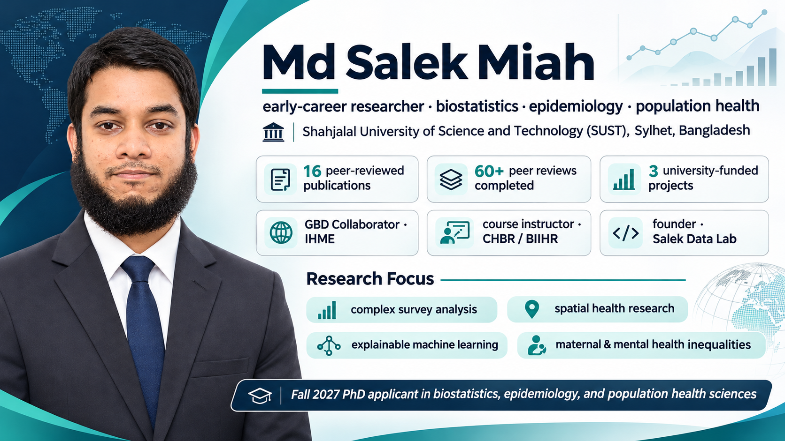</a>
   
  
   
  
  
  
  
  

---

## About Me

I am **Md Salek Miah**, an **early-career researcher** in statistics, biostatistics and population-health research at **Shahjalal University of Science and Technology (SUST), Bangladesh**. My work integrates complex survey methods, statistical modelling, epidemiology, spatial analysis and explainable machine learning to study health inequalities.

**Research and academic profile** *(figures reported in my research records; verify against the current CV before publication)*:

- **16 peer-reviewed publications**, including **two sole-author papers** in *Scientific Reports* and *PLOS ONE*.
- **60+ completed peer reviews** across public-health, medical and interdisciplinary journals.
- **Three university-funded research projects** involving community, ageing and occupational health.
- **GBD Study Collaborator — IHME**; disease-burden research training and collaborative activities.
- **Course instructor — CHBR / BIIHR**; R, Stata, SPSS and applied research methods.
- **Founder — [Salek Data Lab](https://www.youtube.com/@SalekResearch)**; open research education in Bangla.
- **Fall 2027 PhD interests:** Biostatistics, Epidemiology and Population Health Sciences.

  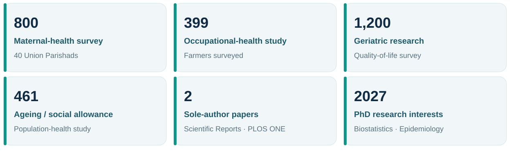

**Research focus:** Developing transparent, reproducible statistical evidence for maternal health, mental health, clinical outcomes and underserved populations.

## Research Agenda and Methods

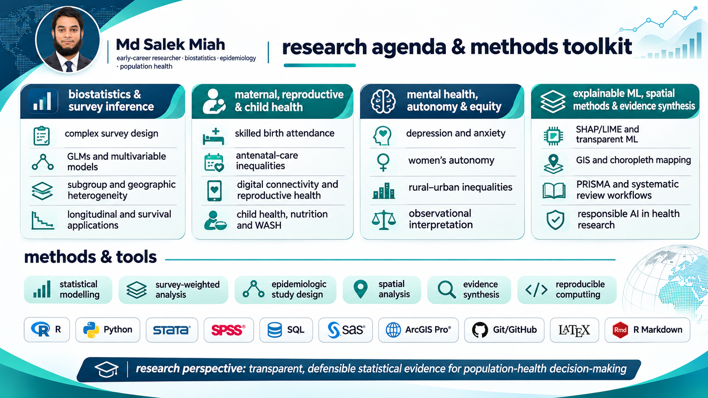

| Focus | Selected interests |
|:--|:--|
| **Biostatistics and epidemiology** | Survey weights and clustering · GLMs · robust inference · subgroup heterogeneity |
| **Maternal and child health** | Skilled birth attendance · antenatal care · reproductive health · nutrition and WASH |
| **Mental health and equity** | Depression and anxiety · women's autonomy · rural–urban disparities |
| **Methods and responsible AI** | SHAP/LIME · GIS mapping · model assessment · evidence synthesis · reproducible research |

**Toolkit:** `R` · `Python` · `Stata 17` · `SPSS` · `SQL` · `SAS` · `ArcGIS Pro` · `Git/GitHub` · `LaTeX` · `R Markdown`

     

## Flagship Published Research

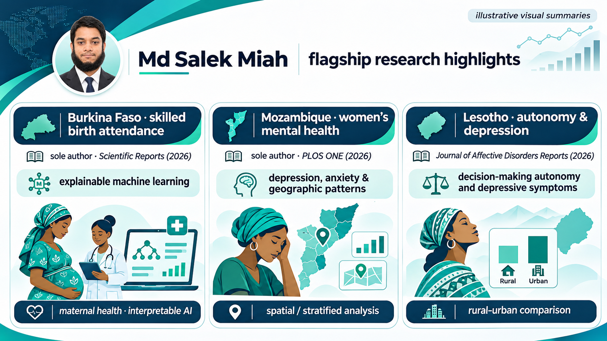

<table>
<tr>
<td align="center" width="33%"><a href="https://www.nature.com/articles/s41598-026-72356-7">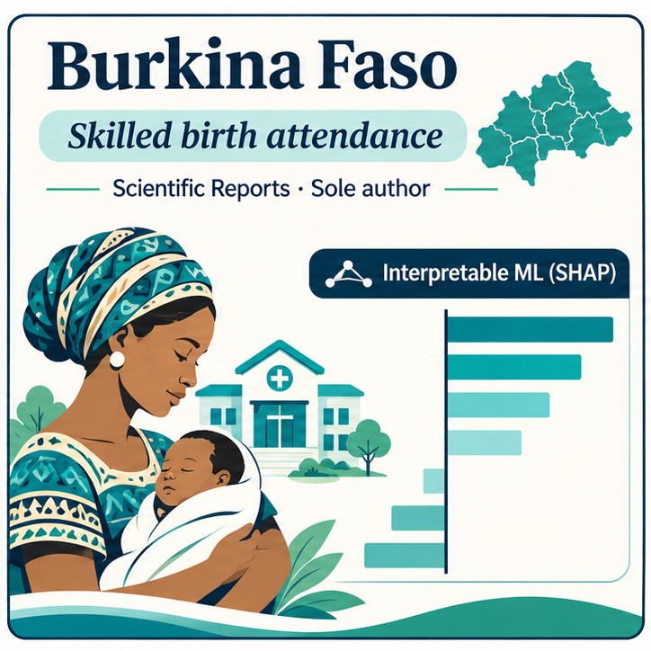</a> <b>Burkina Faso · Skilled Birth Attendance</b> <b>Sole author</b> · <i>Scientific Reports</i> (2026) <a href="https://www.nature.com/articles/s41598-026-72356-7">Read paper</a></td>
<td align="center" width="33%"><a href="https://journals.plos.org/plosone/article?id=10.1371/journal.pone.0356265">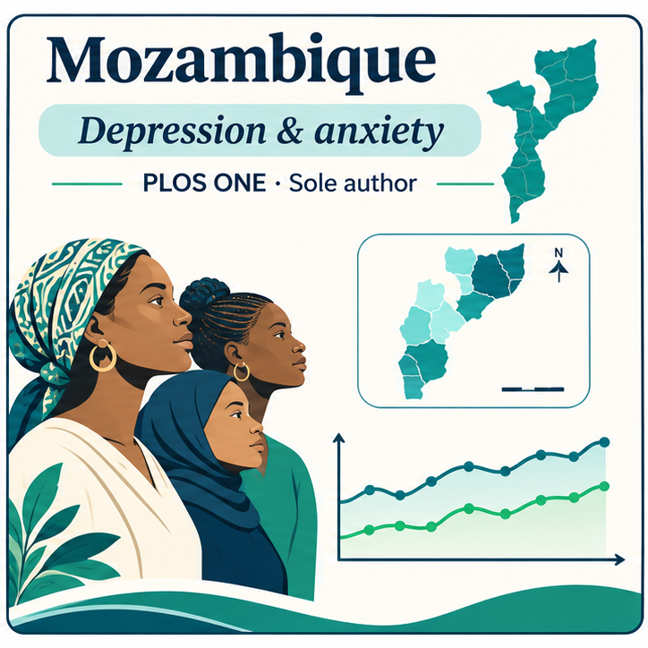</a> <b>Mozambique · Women's Mental Health</b> <b>Sole author</b> · <i>PLOS ONE</i> (2026) <a href="https://journals.plos.org/plosone/article?id=10.1371/journal.pone.0356265">Read paper</a> · <a href="https://github.com/muhammadsalek/mozambique-mental-health-analysis">Code</a></td>
<td align="center" width="33%"><a href="https://www.sciencedirect.com/science/article/pii/S2666915326000594">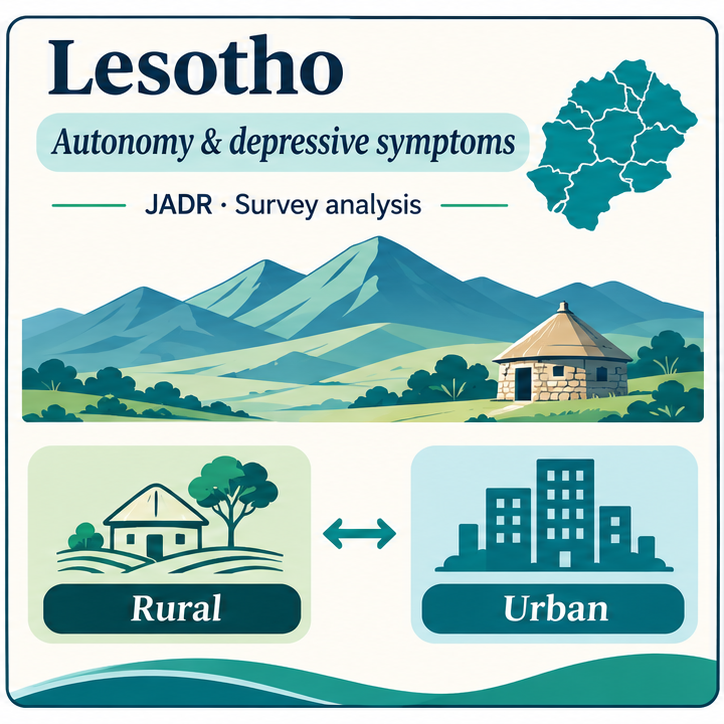</a> <b>Lesotho · Autonomy &amp; Depression</b> <i>Journal of Affective Disorders Reports</i> (2026) <a href="https://www.sciencedirect.com/science/article/pii/S2666915326000594">Read paper</a> · <a href="https://github.com/muhammadsalek/Rural-Urban-Inequalities-in-Depression-among-Ever-Married-Women-in-Lesotho">Code</a></td>
</tr>
</table>

The illustrated figures are visual summaries of research themes, not original study figures or numerical estimates.

<b>View nine selected peer-reviewed publications</b>

| # | Selected publication | Journal / link |
|:--:|:--|:--|
| 1 | **Explainable machine learning analysis of factors associated with skilled birth attendance in Burkina Faso** — sole author | [*Scientific Reports* (2026)](https://www.nature.com/articles/s41598-026-72356-7) |
| 2 | **Stratified and geographic patterns of depression and anxiety in Mozambican women: Mental health policy implications** — sole author | [*PLOS ONE* (2026)](https://doi.org/10.1371/journal.pone.0356265) |
| 3 | **Digital connectivity and mental health symptoms among women in Bangladesh: A rural–urban perspective** | *Discover Mental Health* (2026) · [Portfolio](https://salek-prot.vercel.app/) |
| 4 | **Intimate partner violence and the dual burden of anxiety and depression among women in Zambia** | *Cambridge Prisms: Global Mental Health* (2026) · [Portfolio](https://salek-prot.vercel.app/) |
| 5 | **Decision-making autonomy and depressive symptoms among women in Lesotho: Rural–urban differences** | [*Journal of Affective Disorders Reports* (2026)](https://doi.org/10.1016/j.jadr.2026.101080) |
| 6 | **Association between women's empowerment and mental health in sub-Saharan Africa and South Asia** | *Cambridge Prisms: Global Mental Health* (2026) · [Portfolio](https://salek-prot.vercel.app/) |
| 7 | **Explainable machine learning approaches to predict knowledge of pregnancy danger signs among women in the Haor region of Bangladesh** | *Global Health Research and Policy* (2026) · [Portfolio](https://salek-prot.vercel.app/) |
| 8 | **Association between internet use and unmet need for family planning among currently pregnant women in Bangladesh** | [*BMC Women's Health* (2026)](https://doi.org/10.1186/s12905-026-04788-2) · [Code](https://github.com/muhammadsalek/BDHS-Unmet-Need-Analysis) |
| 9 | **Pregnancy loss and women's mental health in Zambia: A cross-sectional population-based and spatial analysis** | *Health Science Reports* (2026) · [Portfolio](https://salek-prot.vercel.app/) |

**Full bibliography:** [Google Scholar](https://scholar.google.com/citations?user=oV99NYoAAAAJ) · [Research portfolio](https://salek-prot.vercel.app/).

## Four Flagship Research Projects

<table>
<tr>
<td width="50%" valign="top"><a href="https://github.com/muhammadsalek/Rural-Urban-Inequalities-in-Depression-among-Ever-Married-Women-in-Lesotho">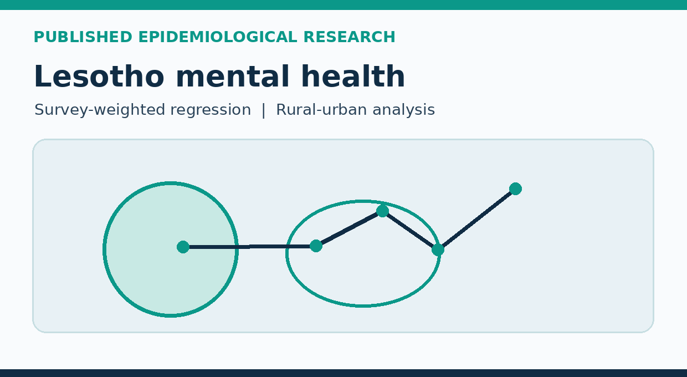</a> <b>Lesotho Mental Health Inequalities</b> Survey-weighted regression · Spatial health analysis <a href="https://github.com/muhammadsalek/Rural-Urban-Inequalities-in-Depression-among-Ever-Married-Women-in-Lesotho">Repository</a></td>
<td width="50%" valign="top"><a href="https://github.com/muhammadsalek/BDHS-Unmet-Need-Analysis">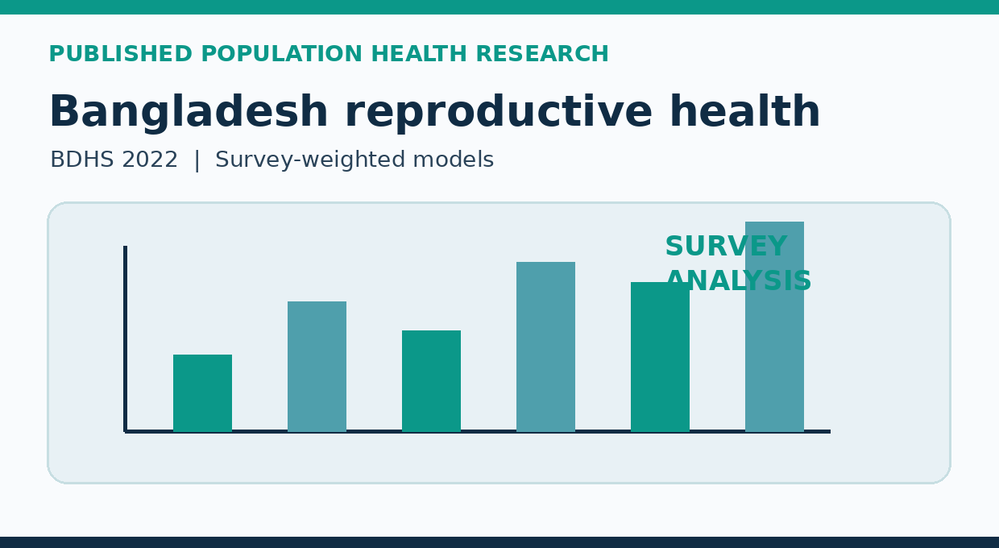</a> <b>BDHS Reproductive Healthcare</b> Survey-weighted inference · Reproductive health equity <a href="https://github.com/muhammadsalek/BDHS-Unmet-Need-Analysis">Repository</a></td>
</tr>
<tr>
<td width="50%" valign="top"><a href="https://salek.shinyapps.io/policyshift/">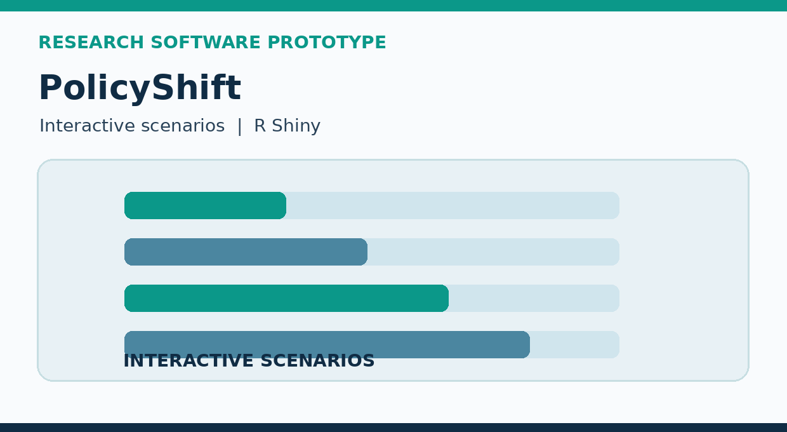</a> <b>PolicyShift</b> Interactive R Shiny scenario exploration; not validated causal estimates <a href="https://salek.shinyapps.io/policyshift/">Live app</a></td>
<td width="50%" valign="top"><a href="https://acoustic-biomarker-gh-salek05.streamlit.app/">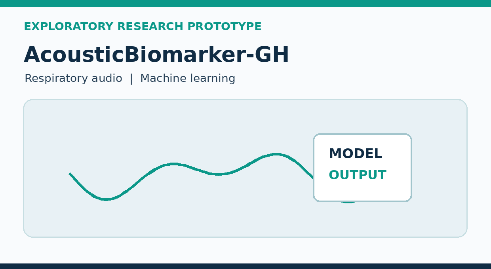</a> <b>AcousticBiomarker-GH</b> Experimental respiratory-audio AI; not clinically validated <a href="https://acoustic-biomarker-gh-salek05.streamlit.app/">Live prototype</a></td>
</tr>
</table>

**Additional open research resources:** [Mozambique code](https://github.com/muhammadsalek/mozambique-mental-health-analysis) · [Statistics for Scientists](https://github.com/muhammadsalek/statistics-for-scientists) · [DHS Stata tutorials](https://github.com/muhammadsalek/DHS-Data-Analysis-with-STATA)

## Research Appointments and Collaborations

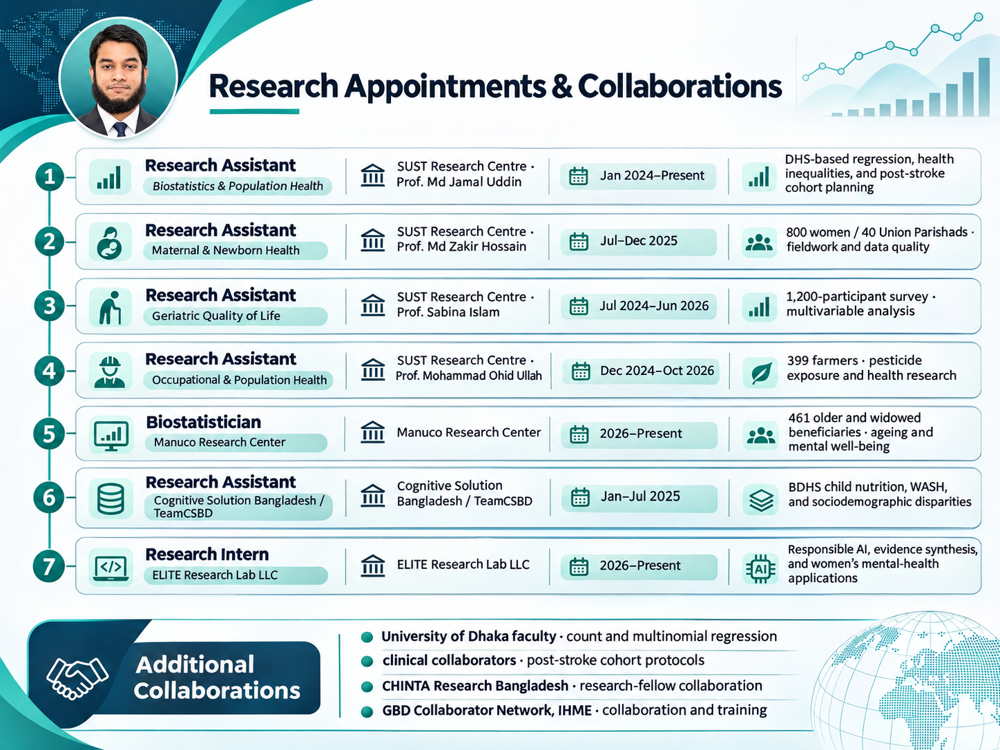

| Appointment / supervisor | Evidence and contributions |
|:--|:--|
| **Biostatistics & Population Health** — SUST Research Centre, **Prof. Md Jamal Uddin** · 2024–present | DHS-based analyses and study design for a prospective post-stroke cohort with clinical collaborators. |
| **Maternal & Newborn Health** — SUST, **Prof. Md Zakir Hossain** · Jul–Dec 2025 | Fieldwork/data quality: **800 women in 40 Union Parishads**; Haor maternal-health research. |
| **Geriatric Quality of Life** — SUST, **Prof. Sabina Islam** · Jul 2024–Jun 2026 | Regression analyses for **1,200 participants**; report and manuscript development. |
| **Occupational & Population Health** — SUST, **Prof. Mohammad Ohid Ullah** · Dec 2024–Oct 2026 | Survey of **399 farmers** on pesticide exposure and health outcomes; EFAST 2026 dissemination. |
| **Biostatistician** — Manuco Research Center · 2026–present | Study of **461 older/widowed beneficiaries** and well-being; manuscript submitted, not published. |
| **Research Assistant** — TeamCSBD · Jan–Jul 2025 | DHS child nutrition, WASH and sociodemographic inequalities. |
| **Research Intern** — ELITE Research Lab LLC · 2026–present | LLMs, responsible AI and evidence synthesis in women's mental health; mini review submitted/in progress. |

<b>Additional collaborations and research supervisors</b>

- **University of Dhaka faculty:** survey-weighted Conway–Maxwell–Poisson and multinomial regression for reproductive health.
- **Clinical collaborators:** post-stroke cohort protocol and longitudinal-analysis planning.
- **CHINTA Research Bangladesh:** research-fellow collaboration.
- **IHME / GBD Network:** collaborator training and disease-burden research activities; collaborator manuscripts are distinguished from independent authored studies.
- Research appointment supervisors: **Prof. Md Jamal Uddin, Prof. Md Zakir Hossain, Prof. Mohammad Ohid Ullah and Prof. Sabina Islam** (specific projects noted above).

## Research Leadership and Scholarly Service

| Area | Role / selected evidence |
|:--|:--|
| **Research leadership** | **PI / Team Lead — YOUReach 2026**: three-person maternal-health/Haor research proposal, **shortlisted for interview** (not a confirmed grant award). |
| **GBD collaboration** | **GBD Study Collaborator**, IHME; training and collaborative research participation. |
| **Peer review** | **60+ completed reviews (self-reported)** across public health, health sciences, applied statistics and interdisciplinary journals. |
| **Community leadership** | **Youth Neglected Tropical Diseases Taskforce** coordinator (2026–present). |
| **Research outreach** | **Founder — Salek Data Lab**, Bengali statistical programming and research education. |

**Selected academic service:** PLOS ONE; *Cambridge Prisms: Global Mental Health*; Springer Nature, IEEE, Taylor & Francis, Sage and Wiley journals. Reviewer reports and confidential editorial material are not shared.

## Teaching and Open Research Education

**Course Instructor — Center for Bio-Health Research (CHBR) and BIIHR (2025–present).** Hands-on courses in R, Stata, SPSS, regression, survey-weighted analysis, public-health methods and introductory ML.

**Additional teaching:** SUST Data Science Club workshops · **Sylhet Engineering College Career Club** mathematics for ML with Python (**15 sessions / 30 hours**) · **Best Promising Instructor Award (2026)**.

### Salek Data Lab — YouTube Playlists

<a href="https://www.youtube.com/@SalekResearch/playlists">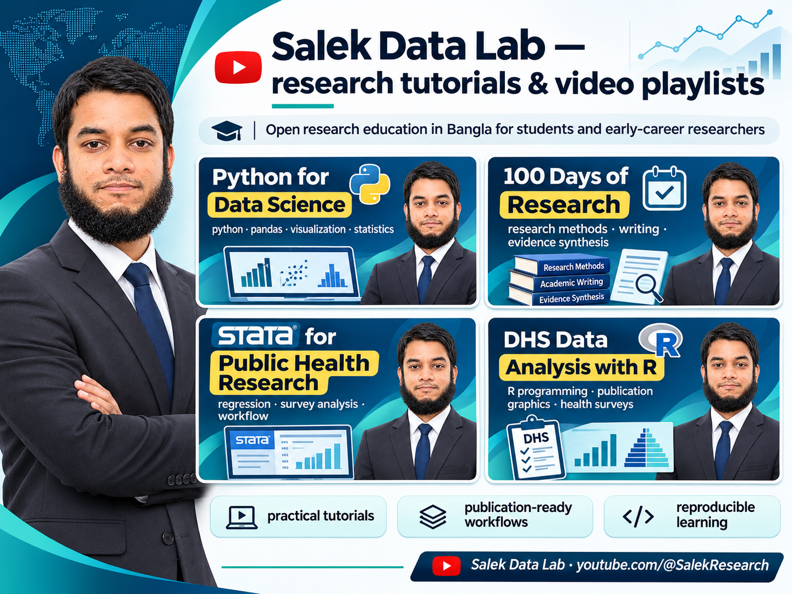</a>

<table>
<tr>
<td align="center" width="50%"> <b>Python for Data Science</b> <a href="https://www.youtube.com/playlist?list=PLJRqglItBi_Q">Watch playlist</a></td>
<td align="center" width="50%"> <b>100 Days of Research</b> <a href="https://www.youtube.com/playlist?list=PLnB0x-ro9UK3zxAOCQmO3EDwCd3dke6f7">Watch playlist</a></td>
</tr><tr>
<td align="center" width="50%"><a href="https://www.youtube.com/@SalekResearch/playlists">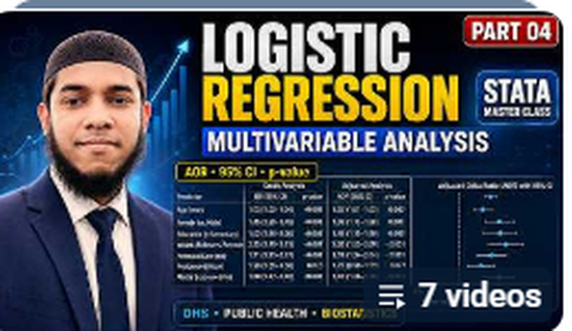</a> <b>Stata for Public Health Research</b> <a href="https://www.youtube.com/@SalekResearch/playlists">Browse playlists</a></td>
<td align="center" width="50%"> <b>DHS Data Analysis with R</b> <a href="https://www.youtube.com/@SalekResearch/playlists">Browse playlists</a></td>
</tr>
</table>

## Education and Recognition

**B.Sc. (Honours) in Statistics**, Shahjalal University of Science and Technology (SUST), Bangladesh · **Expected April 2027** · CGPA: **3.20/4.00** (through Semester 3/2).  
**Selected foundations:** Linear Algebra · Real Analysis · Probability and Statistical Inference · Regression · Sampling · Design of Experiments · Statistical Computing.  
**Advanced coursework in progress:** Multivariate Analysis · Biostatistics and Epidemiology · GLMs.

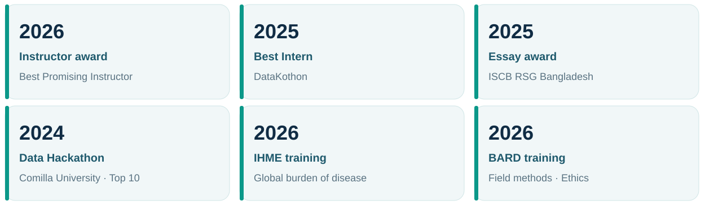

**Selected recognition:** Best Promising Instructor (2026) · Best Intern, DataKothon (2025) · ISCB RSG-Bangladesh DNA Day essay, first place (2025) · Comilla University Data Hackathon, Top 10 (2024).  
**Professional development:** IHME GBD collaborator training · Bangladesh Academy for Rural Development field methods/research ethics · R and Python/ML training.

## GitHub Activity

 

---

**Research collaborations and Fall 2027 PhD opportunities**  
[Research Portfolio](https://salek-prot.vercel.app/) · [Google Scholar](https://scholar.google.com/citations?user=oV99NYoAAAAJ) · [YouTube](https://www.youtube.com/@SalekResearch) · [Email](mailto:saleksta@gmail.com)

